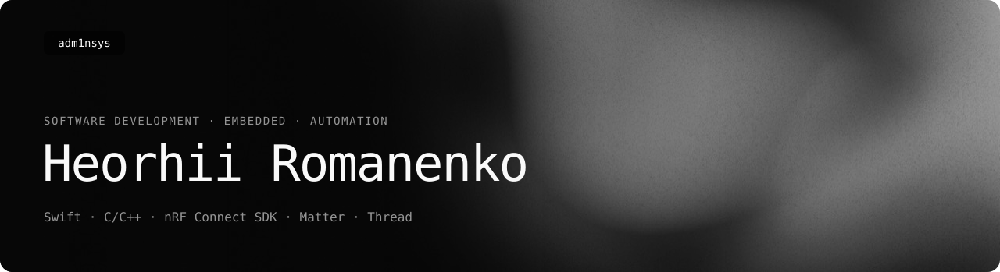

<picture>
  <source media="(prefers-color-scheme: light)" srcset="assets/readme/banner-light.svg">
  
</picture>

  
  
  
  

I automate whatever repeats — build and flashing workflows, release pipelines, smart-home devices.
Native where possible, minimal everywhere: Swift for Apple platforms, C/C++ for microcontrollers, plain HTML/CSS/JS for the web.

## Showcase

### [ServerMaster](https://adm1nsys.github.io/ServerMaster/about/)
`Swift` `SwiftUI` `macOS` `Windows` `CLI`

Local web server manager for macOS and Windows: static sites, PHP with a database, Node.js apps and custom commands — started, stopped and monitored from one window. My largest project and my first app for Windows; a Swift CLI is in the works.

  
  

### [Fernsprecher-KI-Modus](https://adm1nsys.github.io/Fernsprecher-KI-Modus/)
`Swift` `macOS` `FaceTime` `AI agents`

A macOS app and CLI that lets any terminal-based AI agent join a FaceTime call as a guest by link: on-device speech recognition, natural voices and a live status tile.

  
  

→ [All projects](https://adm1nsys.github.io/adm1nsys/projects.html)

## Stack

  

| | |
| --- | --- |
| **Languages** | `Swift` `C` `C++` `JavaScript` `HTML` `CSS` |
| **Frameworks & SDKs** | `SwiftUI` `Arduino` `nRF Connect SDK (Zephyr)` `Matter` `Thread` |
| **Boards** | `nRF54L15 DK` `XIAO nRF54L15` `XIAO ESP32-C6` `ESP8266 DevKit` `nice!nano v2` `Luckfox Pico` `Luckfox Pico Max` |
| **IDE & tools** | `Xcode` `VS Code` `Arduino IDE` [`ServerMaster`](https://adm1nsys.github.io/ServerMaster/about/) `Figma` `Git` |

**Nordic Semiconductor DevAcademy:** nRF54L Series Express · nRF Connect SDK Fundamentals · nRF Connect SDK Intermediate · Bluetooth Low Energy Fundamentals · Designing Low-Power Bluetooth LE Products

**Heilbronn University of Applied Sciences (DAAD):** Engineering and Computer Graphics, 51 h — [certificate](web/assets/files/certificates/hhn-daad-engineering-graphics.pdf) · [coursework](https://adm1nsys.github.io/education/)

🇺🇦 Support Ukraine: [Come Back Alive](https://savelife.in.ua/en/) · [Serhiy Prytula Charity Foundation](https://prytulafoundation.org/en/)

  

