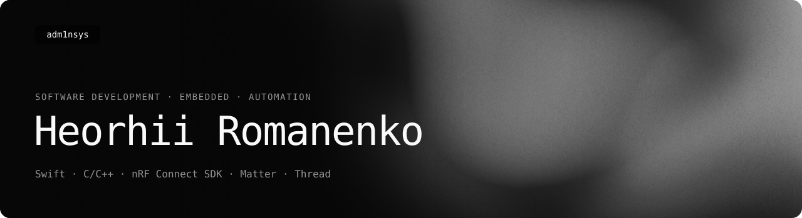

<picture>
  <source media="(prefers-color-scheme: light)" srcset="assets/readme/banner-light.svg">
  
</picture>

  
  
  
  

I automate whatever repeats — build and flashing workflows, release pipelines, smart-home devices.
Native where possible, minimal everywhere: Swift for Apple platforms, C/C++ for microcontrollers, plain HTML/CSS/JS for the web.

## Showcase

### [Concordia](https://github.com/adm1nsys/Concordia)
`C++` `Zephyr` `Matter` `Thread`

Matter-over-Thread bridge built only from microcontrollers: an ESP32-C6 with a web panel pulls data from any HTTP API, an nRF54L15 exposes it as Matter devices for Apple Home, Google Home and Alexa.

### [ServerMaster](https://adm1nsys.github.io/ServerMaster/)
`Swift` `SwiftUI` `Windows` `CLI`

Local web server manager for macOS and Windows: static sites, PHP with a database, Node.js apps and custom commands — started, stopped and monitored from one window. Plus a Swift CLI.

### [Micro Matter Switch](https://github.com/adm1nsys/Micro-Matter-Switch)
`C++` `ESP32-C6` `Matter`

Compact Matter switch based on the XIAO ESP32-C6 with its own 3D-printed case.

### [Safari AI Extension](https://github.com/adm1nsys/Safari-Ai-Extension)
`JavaScript` `Safari` `iOS`

Safari extension generated with Apple Intelligence and then edited by hand. A guide for developers on macOS, iOS and iPadOS 27.

→ [All projects](https://adm1nsys.github.io/adm1nsys/projects.html)

## Stack

  

| | |
| --- | --- |
| **Languages** | `Swift` `C` `C++` `JavaScript` `HTML` `CSS` |
| **Frameworks & SDKs** | `SwiftUI` `Arduino` `nRF Connect SDK (Zephyr)` `Matter` `Thread` |
| **Boards** | `nRF54L15 DK` `XIAO nRF54L15` `XIAO ESP32-C6` `ESP8266 DevKit` `nice!nano v2` `Luckfox Pico` `Luckfox Pico Max` |
| **IDE & tools** | `Xcode` `VS Code` `Arduino IDE` [`ServerMaster`](https://adm1nsys.github.io/ServerMaster/) `Figma` `Git` |

**Nordic Semiconductor DevAcademy:** nRF54L Series Express · nRF Connect SDK Fundamentals · nRF Connect SDK Intermediate · Bluetooth Low Energy Fundamentals · Designing Low-Power Bluetooth LE Products

🇺🇦 Support Ukraine: [Come Back Alive](https://savelife.in.ua/en/) · [Serhiy Prytula Charity Foundation](https://prytulafoundation.org/en/)

  

